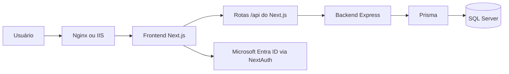
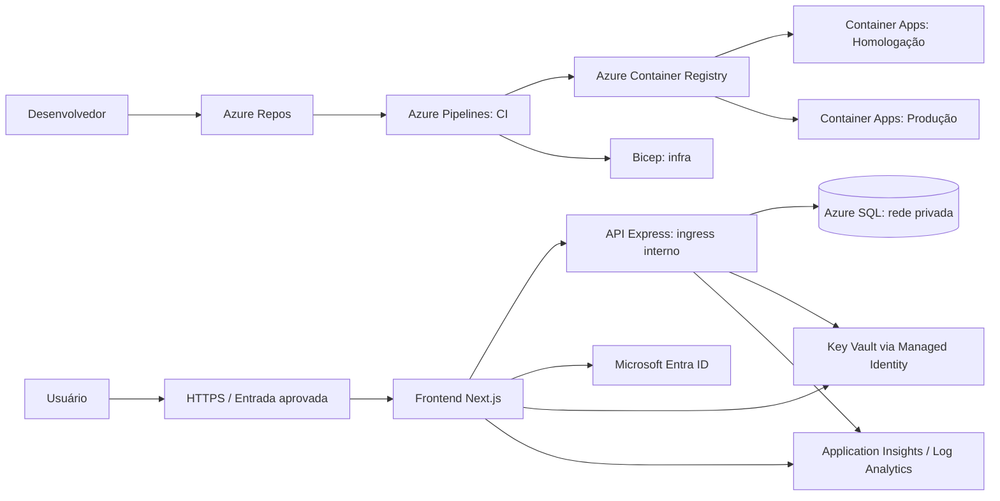

# CAOA Venda Cantada Dash — documentação técnica e operacional

Documento consolidado do projeto e fonte principal para consulta da equipe de
desenvolvimento e DevOps. A estrutura por seções foi preparada para publicação
como página única em uma Wiki do Azure DevOps; os títulos podem ser convertidos
em páginas separadas posteriormente.

[[_TOC_]]

## 1. Visão geral

O CAOA Venda Cantada Dash é uma aplicação web para cadastro e acompanhamento de
intenções de venda. É um monorepo `pnpm` composto por frontend Next.js, API
Express e banco SQL Server acessado por Prisma.

### 1.1 Tecnologias e responsabilidades

| Camada | Tecnologia | Responsabilidade |
| --- | --- | --- |
| Interface | Next.js 15, React 19, Tailwind e VisActor | Cadastro, dashboard, relatórios, gráficos, navegação e gestão de acessos. |
| Autenticação | NextAuth e Microsoft Entra ID | Autentica o usuário e mantém uma sessão JWT. |
| BFF/proxy | Route Handlers do Next.js em `frontend/src/app/api` | Encaminha chamadas da interface ao backend autenticado e aplica timeout. |
| API | Express e TypeScript | Expõe operações de intenções, catálogos, modelos e classificações. |
| Dados | Prisma e SQL Server | Persiste intenções, catálogos, usuários, perfis e permissões. |
| Entrega | Docker, Nginx, IIS ou PM2 | Executa e publica os serviços nos ambientes suportados. |



O fluxo de leitura de dados segue `Página Next.js → /api do Next.js → Express →
Prisma → SQL Server`; a resposta JSON retorna pelo mesmo caminho e a interface
consolida métricas e renderiza os resultados. O cliente de dados de intenções
fica em `frontend/src/lib/salesIntentionApi.ts`; as telas usam
`frontend/src/hooks/useSalesIntentions.ts` ou consultas específicas.

### 1.2 Estrutura principal do repositório

| Caminho | Conteúdo |
| --- | --- |
| `frontend/src/app/` | Páginas, layouts e rotas da API/BFF. |
| `frontend/src/components/` | Componentes de interface, gráficos e navegação. |
| `frontend/src/hooks/` | Hooks de busca e interação. |
| `frontend/src/lib/` | Cliente de API, autenticação e utilitários. |
| `frontend/middleware.ts` | Proteção de grupos de rotas autenticadas. |
| `frontend/server.mjs` | Servidor Next.js de produção. |
| `backend/src/controllers/` | Adaptação HTTP e coordenação de operações. |
| `backend/src/services/` | Regras de negócio. |
| `backend/src/repositories/` | Acesso a dados pelo Prisma. |
| `backend/src/routes/` | Endpoints da API. |
| `backend/src/validators/` | Validação de entradas e query strings. |
| `backend/prisma/schema.prisma` | Modelos e índices do banco. |
| `deploy/` | Configuração Nginx, IIS e diretório de certificados. |
| `scripts/` | Scripts de inicialização e operação. |
| `e2e/` | Testes Playwright. |
| `docker-compose.yml` | Ambiente local com frontend, backend e SQL Server. |
| `docker-compose.prod.yml` | Topologia de produção com Nginx. |
| `azure-pipelines.yml` | Pipeline de CI do Azure DevOps. |
| `.github/workflows/` | Pipeline de CI do GitHub Actions. |

## 2. Funcionalidades

### 2.1 Intenções de venda

- Cadastro, consulta, busca, edição e exclusão sujeitos às permissões do usuário.
- Catálogos carregados pela API; campos de veículo e classificação dependem das
  seleções anteriores.
- Busca por período, tipo de venda e filtros avançados.
- Novos registros guardam o usuário criador.

### 2.2 Dashboard e relatórios

- Dashboard com totais por bandeira, rankings e links para o detalhe de cada
  bandeira.
- Períodos por dia, mês, ano e intervalo personalizado; atalhos anuais para o
  ano atual e os três anos anteriores.
- Skeletons nos totais por bandeira durante carregamentos, sem exibir zeros
  provisórios.
- O detalhe de uma bandeira preserva período e tipo de venda selecionados.
- Relatórios por marca de veículo e por vendedor, com filtros, gráficos,
  exportação e drill-down.

### 2.3 Usuários e permissões

- Gestão administrativa de usuários, perfis, telas liberadas e status.
- Exclusão segura de usuários, preservando as intenções históricas.
- O backend é a fonte de verdade para autorização; a interface apenas reflete as
  permissões e não constitui uma barreira de segurança.

## 3. Requisitos e preparação do ambiente

### 3.1 Máquina e software

**Configuração mínima:** CPU com 2 núcleos, 4 GB de RAM, 20 GB livres em SSD,
Windows 10/11, macOS ou Linux 64-bit e conexão estável com a internet.

**Configuração recomendada:** CPU com 4 núcleos, 8 GB de RAM, 30–40 GB livres
em SSD e conexão estável.

Softwares e acessos necessários:

- Node.js 20 ou superior.
- pnpm 11 ou superior (a versão fixada no projeto é 11.1.3).
- Git.
- SQL Server 2022 ou superior, ou acesso a uma instância SQL Server compatível.
- Docker e Docker Compose para executar o ambiente containerizado.
- Navegador moderno (Chrome, Edge ou Firefox).
- Conta corporativa no tenant Microsoft Entra configurado para testar login.

O Azure Pipelines usa atualmente Node.js 24; o GitHub Actions usa Node.js 20.
Essa diferença entre pipelines deve ser considerada ao investigar resultados
distintos de build.

### 3.2 Configuração local

1. Copie `backend/.env.development.example` para
   `backend/.env.development`.
2. Copie `frontend/.env.development.example` para
   `frontend/.env.development`.
3. Defina o mesmo `BACKEND_AUTH_SECRET` nos dois arquivos.
4. Ajuste `DATABASE_URL` para o SQL Server de desenvolvimento. O exemplo aponta
   para `localhost:1434` e o banco isolado `salesdb_hml`.
5. Configure as credenciais Microsoft Entra do frontend em
   `frontend/.env.local`, conforme a seção [Autenticação Microsoft Entra ID](#5-autenticação-microsoft-entra-id).

O frontend usa o backend local por meio de `/api/*`, com `API_BASE_URL` apontando
para `http://127.0.0.1:4000`. O Next.js carrega
`frontend/.env.development` ao executar `next dev`.

> `backend/.env` não é a configuração de desenvolvimento e pode conter uma
> conexão corporativa. Não o use com `pnpm dev:backend`, `pnpm db:studio`,
> `pnpm db:seed` ou `pnpm --dir backend rbac:seed`. Nunca reutilize credenciais
> de produção nos arquivos de desenvolvimento.

### 3.3 Variáveis de ambiente

Os arquivos `.example` contêm placeholders. Configure valores reais apenas em
arquivos locais ignorados pelo Git ou em um cofre de segredos; nunca versione
segredos, chaves privadas, tokens ou dados de exportação do Active Directory.

| Variável | Uso |
| --- | --- |
| `DATABASE_PROVIDER` | Provider do banco; SQL Server é o padrão atual. |
| `APP_ENV` | Ambiente lógico da aplicação: `development`, `homolog` ou `production`. Define o banco SQL Server permitido. |
| `DATABASE_URL` | Conexão com o banco de dados. |
| `DATABASE_CONNECT_TIMEOUT_SECONDS` | Prazo de conexão SQL; padrão de 30 segundos no backend para conexões com maior latência. Se omitido, preserva um prazo já definido em `DATABASE_URL`. |
| `DATABASE_POOL_TIMEOUT_SECONDS` | Tempo de espera por uma conexão livre no pool; separado do timeout de conexão. O exemplo local usa 60 segundos. |
| `BACKEND_AUTH_SECRET` | Segredo compartilhado pelo frontend/BFF e backend para assinar e validar a identidade encaminhada. |
| `API_BASE_URL` | URL do backend usada pelo BFF e por alguns cenários de execução. |
| `NEXT_PUBLIC_API_BASE_URL` | URL pública de API usada por configurações do frontend. |
| `PORT`, `BACKEND_HOST` | Porta e endereço de escuta do backend. |
| `FRONTEND_PORT`, `FRONTEND_HOST` | Porta e endereço de escuta do frontend. |
| `NEXTAUTH_URL` | URL pública/base do NextAuth; deve coincidir com o endereço de acesso e as URIs cadastradas no Entra ID. |
| `NEXTAUTH_SECRET` | Segredo de sessão do NextAuth. Gere com `openssl rand -base64 32`. |
| `AZURE_AD_CLIENT_ID` | ID do aplicativo Entra ID. |
| `AZURE_AD_CLIENT_SECRET` | Valor do segredo do aplicativo Entra ID. |
| `AZURE_AD_TENANT_ID` | ID UUID do tenant Entra ID. |
| `BACKEND_REQUEST_TIMEOUT_MS` | Timeout das chamadas do BFF para o backend. |
| `TLS_ENABLED`, `FRONTEND_TLS_ENABLED`, `TLS_CERT_PATH`, `TLS_KEY_PATH` | Configurações TLS usadas nos cenários de execução nativa compatíveis. |
| `NEXTAUTH_FALLBACK_AUTH`, `NEXT_PUBLIC_FALLBACK_AUTH` | Ativam, em conjunto, o provedor temporário de credenciais para homologação. |
| `AD_EXPORT_PATH` | Caminho opcional da exportação usada para obter o gestor direto. O arquivo contém dados corporativos e não deve ser versionado. |

Em produção, defina explicitamente `DATABASE_PROVIDER`, `APP_ENV=production`, `DATABASE_URL`,
`BACKEND_AUTH_SECRET`, `NEXTAUTH_SECRET`, `NEXTAUTH_URL` e as credenciais
Microsoft Entra. O provider no schema Prisma deve corresponder ao banco alvo;
trocar dialeto exige regenerar o client e rever/recriar migrations. A camada de
configuração não torna as migrations automaticamente portáveis.

### 3.4 Seleção segura de banco por ambiente

Para evitar publicar ou testar contra a base errada, o backend substitui somente
o nome do banco na `DATABASE_URL` SQL Server conforme `APP_ENV` (ou `NODE_ENV`
quando `APP_ENV` não estiver definido):

| Ambiente | `APP_ENV` | Banco selecionado |
| --- | --- | --- |
| Desenvolvimento local | `development` | `salesdb_hml` |
| Homologação | `homolog` | `salesdb_hml` |
| Produção | `production` | `salesdb` |

As credenciais, host, porta e opções TLS continuam vindo de `DATABASE_URL`.
O mecanismo não cria bancos, não executa migrations por conta própria e não
move dados entre ambientes. No pipeline de Homologação, defina
`APP_ENV=homolog`; no de Produção, use `APP_ENV=production`.

## 4. Executar e operar localmente

### 4.1 Execução sem Docker

Instale as dependências e inicie os serviços em terminais separados:

```bash
pnpm install
pnpm dev:backend
pnpm dev
```

O backend fica em `http://localhost:4000` e o frontend em
`http://localhost:3000`. `pnpm dev:backend` carrega obrigatoriamente
`backend/.env.development` e não aplica migrations automaticamente.

### 4.2 Execução com Docker

```bash
pnpm docker:up
```

Portas locais: frontend `http://localhost:3001`, backend
`http://localhost:4001` e SQL Server `localhost:1433`. Para encerrar:

```bash
pnpm docker:down
```

### 4.3 Banco de desenvolvimento e seeds

O Prisma Studio usa exclusivamente `backend/.env.development`. Confirme que a
conexão aponta para `localhost:1434 / salesdb_hml` antes de editar dados:

```bash
pnpm db:studio
```

Para preencher dados iniciais:

```bash
pnpm db:seed
```

O seed de desenvolvimento recria dados de intenção e catálogos
(`SalesIntention`, `SalesIntentionCatalog` e
`SalesIntentionOptionCombination`) e preserva usuários, roles e permissões.
Para criar ou sincronizar perfis e permissões locais:

```bash
pnpm --dir backend rbac:seed
```

Os comandos de seed usam `backend/.env.development`. Existem também comandos
restritos ao banco local:

```bash
pnpm --dir backend dev:prisma:push
pnpm --dir backend dev:prisma:migrate:deploy
```

Revise a `DATABASE_URL` antes de qualquer operação de schema. Evite
`prisma db push`, `prisma migrate dev` ou `prisma migrate reset` sem revisar o
destino; não os execute contra produção sem aprovação explícita.

### 4.4 Scripts frequentes

| Objetivo | Comando |
| --- | --- |
| Desenvolvimento frontend | `pnpm dev` |
| Desenvolvimento backend | `pnpm dev:backend` |
| Build frontend | `pnpm build` |
| Build backend | `pnpm build:backend` |
| Build de produção | `pnpm build:production` |
| Lint frontend | `pnpm lint` |
| Verificação de tipos | `pnpm typecheck` |
| Testes unitários e integração | `pnpm test:unit` |
| Testes E2E | `pnpm test:e2e` |
| Suite local completa | `pnpm test:all` |
| Prisma Studio | `pnpm db:studio` |
| Seed de dados | `pnpm db:seed` |
| Seed de autorização | `pnpm --dir backend rbac:seed` |

## 5. Autenticação Microsoft Entra ID

### 5.1 Fluxo

O login é iniciado em `/login`. NextAuth usa o provedor Microsoft Entra ID
(Azure AD) e sessão JWT. A configuração principal fica em
`frontend/src/lib/nextAuth.ts`; a rota fica em
`frontend/src/app/api/auth/[...nextauth]/route.ts`.

1. O usuário seleciona **Entrar com Microsoft**.
2. O Entra ID autentica a conta e retorna à
   `/api/auth/callback/azure-ad`.
3. O NextAuth cria a sessão JWT.
4. A aplicação monta o perfil com claims do token e, quando disponível, dados
   complementares do Microsoft Graph.
5. O BFF usa a sessão para validar o usuário e propagar ao Express uma identidade
   curta assinada com `BACKEND_AUTH_SECRET`.

O escopo solicitado é `openid profile email offline_access User.Read`. A sessão
pode conter nome, e-mail, identificador estável, claims do ID token, atributos
corporativos do Graph, foto opcional e gestor direto opcional derivado da
exportação configurada por `AD_EXPORT_PATH`. A foto é servida por
`/api/perfil/foto`; a imagem é opcional e sua ausência não invalida a sessão.

### 5.2 Configurar o registro do aplicativo

1. No [Portal do Azure](https://portal.azure.com), acesse **Microsoft Entra ID**
   → **Registros de aplicativo** → **Novo registro**.
2. Escolha um nome, por exemplo `CAOA Venda Cantada Dash`, e o tipo de conta
   **Contas apenas neste diretório organizacional**.
3. Cadastre uma plataforma Web com a URI do ambiente:
   - Desenvolvimento: `http://localhost:3000/api/auth/callback/azure-ad`
   - IIS: `https://formulariosbi.caoa.com.br/api/auth/callback/azure-ad`
   - Outro ambiente: `https://<host>/api/auth/callback/azure-ad`
4. Copie o **ID do Aplicativo (cliente)** para `AZURE_AD_CLIENT_ID`.
5. Copie o **ID do diretório (locatário)** para `AZURE_AD_TENANT_ID`. Use o UUID
   completo; não use `v2.0` nem `common`.
6. Em **Certificados e Segredos**, crie um segredo e copie seu **valor** (não o
   ID do segredo) para `AZURE_AD_CLIENT_SECRET`. Defina a expiração conforme a
   política corporativa e planeje sua rotação.
7. Em **Permissões de API**, adicione Microsoft Graph, permissões delegadas
   `User.Read`, `openid`, `profile` e `email`; o consentimento administrativo
   pode ser necessário conforme a política do tenant.
8. Cadastre as URIs de redirecionamento exatas para cada ambiente. A URI deve
   corresponder ao host e protocolo configurados em `NEXTAUTH_URL`.

Na configuração local, os valores de autenticação ficam em
`frontend/.env.local`. `NEXTAUTH_SECRET` pode ser gerado com:

```bash
openssl rand -base64 32
```

Reinicie o servidor após alterar configurações:

```bash
pnpm dev
```

Qualquer usuário do tenant configurado pode autenticar; a autorização dentro da
aplicação continua sujeita ao usuário local, perfis e permissões cadastrados.

### 5.3 Proteção de páginas e modo temporário

O middleware protege `/dashboard`, `/relatorios`, `/sales-intention` e
`/configuracoes`; os layouts das áreas internas também verificam a sessão no
servidor. Rotas públicas principais: `/`, `/login`, `/access-denied` e
`/api/auth/*`. A rota `/test-relatorios` é uma tela pública de apoio a testes.

O provedor de credenciais temporárias só é registrado quando **ambas** as
variáveis abaixo estão como `true`:

```env
NEXTAUTH_FALLBACK_AUTH=true
NEXT_PUBLIC_FALLBACK_AUTH=true
```

Esse caminho é exclusivo para homologação controlada. Em produção, mantenha as
variáveis ausentes ou falsas e use Microsoft Entra ID.

### 5.4 Diagnóstico de login

- **Redirecionamento recusado:** confirme que a URI cadastrada é exatamente a
  URL pública seguida de `/api/auth/callback/azure-ad`.
- **Loop de login:** confira `NEXTAUTH_URL`, `NEXTAUTH_SECRET`, domínio, HTTPS e
  cookies aceitos pelo navegador.
- **Acesso negado após login:** confira se o usuário existe localmente e revise
  perfis, status e telas liberadas.
- **Foto ausente:** a foto depende de acesso ao Microsoft Graph e é opcional.
- **Tenant não encontrado:** use o UUID real em `AZURE_AD_TENANT_ID`, não
  `v2.0` nem `common`.
- **Aviso `NEXTAUTH_URL`/`NO_SECRET`:** configure explicitamente `NEXTAUTH_URL`
  e gere `NEXTAUTH_SECRET`.
- **Falha OAuth:** valide client ID, valor do client secret, tenant ID, URI de
  redirecionamento e conectividade de rede.

## 6. Controle de acesso e gestão de usuários

### 6.1 Modelo de autorização

O backend é a fonte de verdade. O BFF valida a sessão Microsoft, assina uma
identidade curta com `BACKEND_AUTH_SECRET` e o Express valida essa assinatura
antes de carregar o usuário local e suas permissões. A aplicação aplica
autenticação no middleware do Express e permissões nas rotas protegidas.

A autorização depende das permissões vinculadas aos perfis do usuário.
**Regional** é um atributo de uma intenção e pode ser usado em filtros e
relatórios, mas não restringe o acesso de um usuário.

| Perfil | Capacidades principais |
| --- | --- |
| `USER` | Opera intenções conforme permissões atribuídas. |
| `MANAGER` | Opera intenções e relatórios conforme permissões atribuídas. |
| `VIEWER` | Consulta intenções e relatórios conforme permissões atribuídas. |
| `ADMIN` | Acesso administrativo e todas as permissões da plataforma. |

### 6.2 Permissões por tela

Cada usuário possui uma lista explícita de telas liberadas, além das permissões
dos perfis. O administrador configura a lista em Gestão de acessos. As telas
atuais são Intenções de venda, Dashboard, Relatório por marca, Relatório por
vendedor, Perfil e Gestão de acessos.

O menu oculta telas não liberadas e o frontend encaminha tentativas de acesso
direto a `/access-denied`; o backend continua responsável pela autorização. A
tela de Gestão de acessos sempre exige `ADMIN`, mesmo que conste na lista de
telas do usuário. A migration de criação libera todas as telas para usuários
preexistentes, preservando acessos; usuários criados no primeiro login precisam
ter as telas liberadas por um administrador.

### 6.3 Gestão de acessos

A interface fica em `/admin/access-management`. Ela permite pesquisar e
paginar usuários, editar perfis e status, selecionar telas liberadas e excluir
usuários. A página e as rotas administrativas exigem `ADMIN`.

| Método | Endpoint no backend | Finalidade |
| --- | --- | --- |
| `GET` | `/users/access-management/context` | Contexto do administrador autenticado. |
| `GET` | `/users/access-management?search=&name=&email=&role=&active=&page=&pageSize=` | Lista paginada de usuários e perfis. |
| `GET` | `/users/roles` | Lista perfis cadastrados. |
| `GET` | `/users/screens` | Lista telas disponíveis para atribuição. |
| `GET` | `/users/:id/roles` | Consulta perfis de um usuário. |
| `PUT` | `/users/:id/roles` | Substitui os perfis de um usuário. |
| `PUT` | `/users/:id/screens` | Substitui telas liberadas. |
| `PATCH` | `/users/:id/status` | Ativa ou desativa usuário. |
| `DELETE` | `/users/:id` | Exclui usuário e vínculos de perfil. |
| `GET` | `/users/me/access` | Retorna perfis do usuário autenticado. |
| `GET` | `/users/me/screens` | Retorna telas liberadas ao usuário. |

O backend impede que um administrador remova, desative ou exclua a própria
conta, ou remova/desative/exclua o último administrador ativo. Ao excluir um
usuário, as intenções históricas são preservadas e `createdByUserId` é removido.

## 7. Rotas da aplicação e API

### 7.1 Páginas

| Rota | Finalidade | Acesso |
| --- | --- | --- |
| `/` | Entrada da aplicação. | Pública. |
| `/login` | Login Microsoft. | Pública. |
| `/dashboard` | Painel de vendas cantadas. | Sessão autenticada e tela liberada. |
| `/dashboard/bandeiras/[bandeira]` | Detalhe de bandeira. | Sessão autenticada e tela liberada. |
| `/relatorios/marca` | Relatório por marca de veículo. | Sessão autenticada e tela liberada. |
| `/relatorios/vendedor` | Relatório/comparativo de vendedores. | Sessão autenticada e tela liberada. |
| `/sales-intention` | Cadastro e gestão de intenção. | Sessão autenticada e tela liberada. |
| `/perfil` | Dados do perfil do usuário. | Sessão autenticada e tela liberada. |
| `/admin/access-management` | Gestão de usuários, perfis, status e telas. | `ADMIN`. |
| `/access-denied` | Exibição de acesso negado. | Pública. |
| `/test-relatorios` | Apoio a testes. | Pública. |

### 7.2 Endpoints de negócio

As rotas web do BFF usam prefixo `/api` e encaminham ao Express removendo esse
prefixo.

| Método e rota web | Rota do backend | Uso |
| --- | --- | --- |
| `GET /api/sales-intentions` | `GET /sales-intentions` | Lista por período e tipo de venda. |
| `GET /api/sales-intentions/search` | `GET /sales-intentions/search` | Busca com filtros avançados. |
| `GET /api/sales-intentions/:id` | `GET /sales-intentions/:id` | Consulta detalhe. |
| `POST /api/sales-intentions` | `POST /sales-intentions` | Cria intenção. |
| `PUT /api/sales-intentions/:id` | `PUT /sales-intentions/:id` | Atualiza intenção. |
| `DELETE /api/sales-intentions/:id` | `DELETE /sales-intentions/:id` | Remove intenção conforme permissão. |
| `GET /api/sales-intention-catalogs` | `GET /sales-intention-catalogs` | Catálogos e opções de formulário. |
| `GET /api/sales-intention-modelos-dealer` | `GET /sales-intention-modelos-dealer` | Combinações de veículos e consulta por placa. |
| `GET /api/sales-intention-classificacoes` | `GET /sales-intention-classificacoes` | Classificações de venda. |
| `GET /api/users/me/access` | `GET /users/me/access` | Perfis e acesso do usuário atual. |
| `GET /api/users/access-management` | `GET /users/access-management` | Lista administrativa de usuários. |
| `DELETE /api/users/:id` | `DELETE /users/:id` | Exclusão administrativa segura. |

Exemplo de busca no backend:

```text
GET /sales-intentions/search?proprietario=hermano&tipoVenda=NOVOS&startDate=2025-06-01&endDate=2025-06-30
```

O backend também expõe `GET /health`, `GET /docs` (Swagger) e
`GET /openapi.json` (contrato OpenAPI). Com o backend local ativo, acesse
`http://localhost:4000/docs` ou `http://localhost:4000/openapi.json`.

### 7.3 Modelos de dados

| Modelo Prisma | Papel |
| --- | --- |
| `SalesIntention` | Registro principal da intenção de venda; `dataSolicitacao` é o principal eixo temporal de dashboard e relatórios. |
| `SalesIntentionCatalog` | Fontes de opções de formulário/filtro, incluindo tipo, bandeira, regional e marca. |
| `SalesIntentionOptionCombination` | Combinações normalizadas; inclui chave única e índices por tipo/bandeira/regional. |
| `User`, `Role`, `Permission` | Identidade local, perfis e permissões. |
| `Screen`, `UserScreen` | Catálogo de telas e vínculo de telas por usuário, com chave composta. |

O schema está em `backend/prisma/schema.prisma`.

## 8. Testes e integração contínua

### 8.1 Testes locais

- **Unitários e componentes:** Vitest, Testing Library e `user-event` no
  frontend; Vitest no backend.
- **Integração da API:** Supertest verifica contratos HTTP do Express com
  serviços mockados, sem exigir SQL Server.
- **E2E:** Playwright/Chromium inicia o Next.js e valida fluxos como rota
  protegida e login. Login Microsoft real não é automatizado, pois exige
  credenciais corporativas.

Instale o Chromium quando necessário:

```bash
pnpm --filter caoa-venda-cantada-web exec playwright install chromium
```

Comandos disponíveis:

```bash
pnpm test:unit
pnpm test:coverage
pnpm test:e2e
pnpm test:e2e:ui
pnpm test:e2e:headed
pnpm test:e2e:debug
pnpm test:e2e:report
pnpm test:all
```

`E2E_BASE_URL` deve ser usado apenas para ambiente de homologação controlado.
Sem essa variável, o Playwright usa o servidor local. Relatórios, resultados e
cobertura são ignorados pelo Git.

### 8.2 Azure Pipelines

O arquivo `azure-pipelines.yml` executa CI em pushes para `main` e `develop`,
em agente `ubuntu-24.04`, usando Node.js 24 e pnpm 11.1.3. As etapas atuais são:

1. Instalação do pnpm e dependências com `pnpm install --frozen-lockfile`.
2. Geração do Prisma Client.
3. Lint.
4. Verificação TypeScript do frontend e backend.
5. Build do backend e do frontend.

O pipeline Azure atualmente não executa testes unitários/E2E, não publica
artefatos e não faz deploy.

### 8.3 GitHub Actions

`.github/workflows/docker-image.yml` executa em push e pull request para
`main`, usando Node.js 20 e pnpm 11.1.3. Executa instalação congelada,
lint, typecheck, testes unitários/integração, instalação de Chromium, E2E e
build de imagem Docker. Em falha dos testes E2E, envia artefatos Playwright.

Como a meta informada é concentrar o ciclo de desenvolvimento no Azure DevOps,
decidir com a equipe quando desativar esse workflow. Evite manter verificações
duplicadas ou dois processos de deploy concorrentes; preserve-o até a pipeline
Azure ter cobertura equivalente e a migração ser aprovada.

### 8.4 Testes de carga

Documentação anterior mencionava `load-tests/k6/`, `load-tests/README.md` e o
comando `pnpm test:load:60`, mas esses arquivos/diretório e script não estão
presentes no repositório revisado. Portanto, não execute esse comando como se
estivesse disponível. Planeje ou restaure o teste de carga antes de incluí-lo na
rotina de CI; quando implementado, execute apenas em homologação ou janela
autorizada.

## 9. Arquitetura-alvo na Azure (proposta)

Esta seção converte a documentação para o cenário de hospedagem em nuvem pedido
para o projeto. É uma **arquitetura de referência**, ainda não provisionada nem
aprovada. A escolha de SKUs, topologia de rede, região final, banco de dados,
domínios, metas de disponibilidade, RPO/RTO e custos precisa ser validada com
Arquitetura, Segurança, Redes, DBA e FinOps antes de criar recursos.

### 9.1 Serviços recomendados

Como o repositório já contém imagens Docker para o frontend e backend, a
recomendação inicial é manter essa forma de empacotamento e avaliar Azure
Container Apps. O frontend seria acessível pela internet corporativa ou pública
conforme decisão de rede; o backend teria ingress interno, acessível apenas pelo
frontend dentro do ambiente. O banco não deve ser exposto publicamente.

| Componente | Serviço Azure de referência | Observação / validação necessária |
| --- | --- | --- |
| Frontend Next.js | Azure Container Apps | Container com porta de escuta `3003`; ingress externo somente se aprovado, HTTPS obrigatório. |
| API Express | Azure Container Apps | Container com porta `4000`; ingress interno e acesso restrito ao frontend. |
| Imagens | Azure Container Registry (ACR) | Repositório privado; publicar imagens imutáveis identificadas por commit/build. |
| Banco | Azure SQL Database como primeira opção a avaliar | Confirmar compatibilidade do schema, migrations Prisma, volume, performance e recursos SQL utilizados. Azure SQL Managed Instance é alternativa se a compatibilidade exigir maior fidelidade ao SQL Server. |
| Segredos | Azure Key Vault | Segredos de autenticação e conexão; acesso por identidade gerenciada e privilégio mínimo. |
| Identidade de runtime | Managed Identity | Uma identidade por aplicação/ambiente quando possível; habilitar RBAC apenas nos recursos necessários. |
| Telemetria e logs | Application Insights e Log Analytics | Instrumentar frontend/backend e configurar retenção, alertas e consultas sem registrar tokens ou dados sensíveis. |
| Pipeline | Azure DevOps Pipelines | YAML versionado no repositório; conexão Azure com workload identity federation quando suportada. |
| IaC | Bicep em `infra/` | Criar recursos reproduzíveis com parâmetros separados para homologação e produção. |
| Entrada/domínio | Ingress do Container Apps; avaliar Azure Front Door ou Application Gateway | A decisão depende de domínio, exposição pública, WAF, rede privada e requisitos corporativos. Não assumir nem provisionar até aprovação. |



### 9.2 Separação de homologação e produção

Homologação e produção devem ter isolamento de dados, configurações e acessos.
Usar assinaturas separadas é preferível quando a governança da organização
permite; caso contrário, usar grupos de recursos distintos e políticas/RBAC
equivalentes. A topologia final deve seguir a landing zone corporativa.

| Item | Homologação | Produção |
| --- | --- | --- |
| Recursos | Container Apps, ACR e banco isolados ou segregação aprovada. | Recursos próprios, sem dependência operacional de homologação. |
| Dados | Dados sintéticos ou anonimizados; não copiar dados pessoais de produção sem autorização. | Dados operacionais protegidos e acesso auditado. |
| Deploy | Automático após merge na branch acordada e CI verde. | Aprovação manual, janela/checks e artefato já validado em homologação. |
| Segredos | Key Vault/escopo de homologação e identidade próprios. | Key Vault/escopo de produção e identidade próprios, acesso mais restrito. |
| Rede | Sem acesso público ao banco; ingress de acordo com VPN/rede corporativa. | Restringir ingress e dados conforme arquitetura de segurança aprovada. |
| Monitoramento | Alertas e logs separados; validar comportamento antes da promoção. | Alertas de disponibilidade, erros, latência, dependências, quota e custo. |

### 9.3 Configuração e segredos

- Manter no repositório somente nomes de variáveis e valores não secretos.
- Armazenar `AZURE_AD_CLIENT_SECRET`, `NEXTAUTH_SECRET` e credenciais de banco
  no Key Vault; injetá-los por integração segura/identidade gerenciada. Não
  gravar segredos em YAML, parâmetros versionados, logs ou artefatos.
- Definir configurações distintas por ambiente: `NEXTAUTH_URL`,
  `API_BASE_URL`, `BACKEND_AUTH_SECRET`, banco, timeouts e URLs de callback.
- Nunca reutilizar secret ou banco de produção em homologação.
- Preferir service connection do Azure DevOps com workload identity federation
  a segredo de service principal de longa duração. Restringir o escopo RBAC da
  conexão e da identidade de runtime.
- Rotacionar segredos e revisar acesso periodicamente. Não atribuir Owner ou
  Contributor em escopo amplo quando uma role mais restrita for suficiente.

O backend atual precisa do `BACKEND_AUTH_SECRET` compartilhado com o BFF e usa
`DATABASE_URL`. A substituição da autenticação SQL por Microsoft Entra/Managed
Identity não deve ser presumida: valide suporte ponta a ponta com Prisma e com a
versão instalada antes de planejar essa mudança. Até essa validação, guardar a
credencial de banco no Key Vault é a opção de compatibilidade a avaliar.

### 9.4 Banco de dados e migrations

O projeto usa provider `sqlserver` no Prisma e mantém migrations em
`backend/prisma/migrations/`. Antes de escolher Azure SQL Database:

1. Inventariar tipos, índices, constraints, queries e recursos específicos do
   SQL Server usados pelo schema e pela aplicação.
2. Aplicar todas as migrations em uma cópia não produtiva do banco-alvo e
   validar leitura, gravação, seeds necessários e performance.
3. Confirmar conectividade privada, TLS, regras de firewall e configuração de
   conexão/pool para os containers.
4. Definir backup automático, retenção, point-in-time restore, geo-restore e
   procedimento testado de recuperação segundo RPO/RTO aprovado.
5. Executar migrations como etapa explícita e auditável do release, em ordem
   controlada e com estratégia compatível com rollback. Não executar seeds
   destrutivos de desenvolvimento em produção.

O backup gerenciado não substitui teste de restauração. RPO, RTO, retenção e
região de recuperação continuam pendentes de decisão de negócio/DBA.

### 9.5 Pipeline CI/CD proposto

O `azure-pipelines.yml` atual é apenas CI: compila e valida código; não publica
imagens, não aplica IaC e não faz deploy. A evolução recomendada é:

1. **Pull request/CI:** instalação congelada; Prisma Client; lint; typecheck;
   testes unitários/integração; E2E quando o agente suportar Chromium; build dos
   dois containers; análise de dependências e segurança.
2. **Publicação:** publicar frontend e backend no ACR com tags imutáveis
   (`Build.SourceVersion`/commit SHA), além de metadados do build. Não usar
   `latest` como referência de release.
3. **Infraestrutura:** validar Bicep com lint/what-if; provisionar alterações
   aprovadas por ambiente, sem misturar deploy de aplicação com mudanças
   destrutivas de dados.
4. **Homologação:** após merge para a branch definida, aplicar migrations
   aprovadas e publicar os mesmos digests de imagem gerados pelo CI; executar
   smoke tests e validar saúde/logs.
5. **Produção:** promover o mesmo artefato já validado; exigir aprovação manual
   e checks no Environment protegido do Azure DevOps antes de iniciar.
6. **Pós-deploy:** verificar `/health`, login corporativo, APIs, métricas,
   erros e dependências; parar a promoção e iniciar rollback se falhar o critério
   de aceite.

Não mover automaticamente para produção após somente um build verde. Configurar
branch policies, revisores, builds obrigatórios, resolução de comentários e
restrição de push direto em branches protegidas. Aprovações de produção devem
ser configuradas como checks do Environment no Azure DevOps, fora do YAML para
evitar que uma alteração de pipeline contorne a aprovação.

### 9.6 Estratégia inicial de branches e versões

Proposta a aprovar com a equipe:

- `main`: código liberável; sem push direto; PR obrigatório e build verde.
- `develop`: integração destinada à próxima homologação; PR obrigatório.
- `feature/*` e `bugfix/*`: mudanças isoladas vinculadas a item do Azure Boards.
- `release/*`: opcional, somente se houver janela de estabilização/release.
- `hotfix/*`: correção urgente derivada da versão de produção, revisada e
  propagada de volta a `develop`.
- Tags de release semânticas, vinculadas ao commit e artefatos implantados.
- Convenção de commits aprovada pelo time e associação de PR/commit a Work Items.

O pipeline atual dispara em `main` e `develop`; antes de ativar CD, alinhar esses
gatilhos com a estratégia final e com as políticas do repositório Azure Repos.

### 9.7 Backlog de implantação Azure DevOps

Backlog transcrito da planilha `Venda_Cantada_Backlog.xlsx`, aba `tarefas`.
Os IDs e dependências abaixo refletem o arquivo recebido; valide os itens no
Azure Boards antes da importação e mantenha as relações de dependência ao criar
os Work Items.

| ID | Módulo | Tarefa | Pré-requisito |
| --- | --- | --- | --- |
| PB-104 | Planejamento | Levantar arquitetura atual, integrações, dependências e requisitos de disponibilidade; definir serviço Azure para frontend/backend. | — |
| PB-105 | Azure DevOps | Criar e configurar projeto, times, permissões iniciais e grupos de acesso. | PB-104 |
| PB-106 | Azure Repos | Criar/migrar repositório preservando histórico e branches necessárias. | PB-105 |
| PB-107 | Controle de Versão | Definir branches `main`, `develop`, `feature`, `release`, `hotfix`, commits, tags e releases. | PB-106 |
| PB-108 | Controle de Versão | Configurar PR obrigatório, revisão, build obrigatório, bloqueio de push direto e resolução de comentários. | PB-107 |
| PB-109 | Azure Boards | Configurar backlog, épicos, features, histórias, bugs, sprints, responsáveis e fluxo. | PB-105 |
| PB-110 | Governança | Definir nomenclatura, tags, ownership, centro de custo e alertas de orçamento. | PB-104 |
| PB-111 | Segurança | Configurar identidade, RBAC, grupos, regras de rede, domínios, certificados e controles base. | PB-104 |
| PB-112 | Infraestrutura | Criar IaC (Bicep ou Terraform) para recursos compartilhados e por ambiente. | PB-104, PB-110, PB-111 |
| PB-113 | Ambiente Homolog | Provisionar homologação por IaC, isolada de produção. | PB-112 |
| PB-114 | Ambiente Produção | Provisionar produção por IaC com capacidade, segurança e disponibilidade definidas. | PB-112 |
| PB-115 | Segurança | Criar Key Vaults separados e configurar secrets, chaves, certificados e conexões. | PB-113, PB-114 |
| PB-116 | Azure DevOps | Configurar service connections, variáveis protegidas e permissões de deploy. | PB-105, PB-111, PB-115 |
| PB-117 | Empacotamento | Definir e implementar empacotamento/publicação de frontend e backend. | PB-104, PB-106 |
| PB-118 | CI Backend | Criar CI do backend: dependências, lint, testes, build, segurança e artefato. | PB-108, PB-117 |
| PB-119 | CI Frontend | Criar CI do frontend: dependências, lint, testes, build, segurança e artefato. | PB-108, PB-117 |
| PB-120 | Qualidade | Configurar cobertura, análise de qualidade e gates de PR. | PB-118, PB-119 |
| PB-121 | Artefatos | Configurar retenção, versionamento, rastreabilidade e armazenamento de artefatos/imagens. | PB-117, PB-118, PB-119 |
| PB-122 | Banco de Dados | Versionar migrations e controlar atualização de banco em homologação e produção. | PB-113, PB-114, PB-115 |
| PB-123 | CD Homolog | Criar deploy contínuo de homologação com configuração/secrets próprios. | PB-113, PB-116, PB-118, PB-119, PB-121, PB-122 |
| PB-124 | Validação | Automatizar smoke tests, health checks e validações pós-deploy em homologação. | PB-123 |
| PB-125 | CD Produção | Promover para produção somente artefatos validados em homologação. | PB-114, PB-116, PB-121, PB-124 |
| PB-126 | Aprovações | Configurar aprovações manuais, checks, janela de mudança e validações de segurança. | PB-125 |
| PB-127 | Rollback | Automatizar rollback de aplicação, artefatos e banco; validar em homologação. | PB-122, PB-125 |
| PB-128 | Observabilidade | Configurar Application Insights e Log Analytics com correlação de logs/erros. | PB-113, PB-114 |
| PB-129 | Monitoramento | Criar alertas, dashboards e notificações de disponibilidade, erros, performance e pipelines. | PB-128 |
| PB-130 | Continuidade | Configurar backup, retenção, recuperação e contingência para dados/configuração/recursos. | PB-114, PB-115, PB-122 |
| PB-131 | Documentação | Documentar arquitetura, inventário, variáveis, pipelines, release, rollback e operação; realizar handover. | PB-104 a PB-130 |

### 9.8 Dados para solicitação de recursos Azure

Resumo da aba `Planilha1` do arquivo recebido. Valores que dependem de decisão
técnica, aprovação ou cálculo de preço estão explicitamente marcados como
pendentes; não devem ser tratados como aprovação nem orçamento.

| Campo | Valor para registrar | Situação |
| --- | --- | --- |
| Data da solicitação | 14/10/2026 | Informado. |
| Canal de origem | E-mail | Informado. |
| Solicitante | Samuel Alencar (Sistemas) | Informado; registrar e-mail no formulário corporativo, não nesta documentação. |
| Projeto / orçamento | Venda Cantada / A definir | Conforme planilha; centro de custo/orçamento pendente. |
| Nuvem | Microsoft Azure | Informado. |
| Ambiente | Homologação e Produção | Informado; devem ser isolados. |
| Tipo / nome do recurso | Azure DevOps (Repos, Pipelines e Boards) + hospedagem da aplicação; `AZUETL01/10.200.2.25` | Conforme planilha; confirmar se é ambiente de referência, origem da migração ou recurso pretendido. Não assumir como endpoint público. |
| Região / datacenter | Brazil South | Conforme planilha; validar disponibilidade, política corporativa, DR e custo. |
| Dimensionamento | Similar a `AZUETL01` | Texto da planilha; obter CPU, memória, armazenamento e métricas atuais antes de traduzir em serviços/SKUs Azure. |
| Status | Em planejamento | Conforme planilha. |
| Data de subida | A definir após aprovação | Conforme planilha; planejar após provisionamento e janela de mudança. |
| Expiração / review | `-` | Conforme planilha; decidir se o recurso tem validade ou revisão periódica. |
| Gestor responsável | Jonathan Felix Dos Santos | Informado. |
| Modelo de cobrança | `-` | Conforme planilha; definir com FinOps/contrato Azure após sizing. |
| Custo mensal estimado (BRL) | `-` | Conforme planilha; estimar por ambiente com SKUs/região e custos de compute, banco, logs, rede e registry. |
| Justificativa / projeto | Migrar Venda Cantada para Azure, centralizando código-fonte, controle de versão, CI/CD, ambientes de homologação e produção, monitoramento e controles de acesso. | Conforme planilha. |
| Aprovador | Jonathan Felix Dos Santos | Conforme planilha; confirmar autoridade formal de aprovação. |
| Observações | Levantar aplicação, dependências, banco, integrações, DNS, certificados, backup, rollback e requisitos de segurança. | Conforme planilha; complementar após assessment. |

### 9.9 Decisões bloqueadoras antes de provisionar

1. Aprovar ou substituir Azure Container Apps como hospedagem.
2. Confirmar Azure SQL Database, Managed Instance ou outro destino compatível
   com o provider SQL Server e as migrations Prisma.
3. Confirmar se `AZUETL01` e `10.200.2.25` são recursos existentes, origem da
   migração ou apenas valores do formulário.
4. Definir exposição (internet, VPN/rede corporativa), DNS, TLS, ingress e
   necessidade de Front Door/Application Gateway.
5. Definir assinatura, tenant, região efetiva, resource groups, naming,
   conectividade privada, quotas e políticas da landing zone.
6. Definir sizing/carga, orçamento mensal, retenção de logs, política de backup,
   RPO/RTO, janelas e aprovadores.
7. Validar autenticação Entra ID, callback URLs e compatibilidade de Prisma/
   banco em um ambiente não produtivo.

### 9.10 Referências oficiais Microsoft

- [Azure Container Apps — visão geral](https://learn.microsoft.com/azure/container-apps/overview)
- [Proteção de aplicações no Azure Container Apps](https://learn.microsoft.com/azure/container-apps/secure-app)
- [Arquitetura e boas práticas de Azure SQL Database](https://learn.microsoft.com/azure/azure-sql/database/architecture-best-practices)
- [Backups automáticos e restauração do Azure SQL](https://learn.microsoft.com/azure/azure-sql/database/automated-backups-overview)
- [Workload identity federation para service connections do Azure DevOps](https://learn.microsoft.com/azure/devops/pipelines/library/connect-to-azure)
- [Políticas de branch do Azure Repos](https://learn.microsoft.com/azure/devops/repos/git/branch-policies)
- [Aprovações e checks em pipelines Azure DevOps](https://learn.microsoft.com/azure/devops/pipelines/process/approvals)
- [Visão geral do Azure Key Vault](https://learn.microsoft.com/azure/key-vault/general/overview)

## 10. Publicação e operação atuais

As instruções desta seção descrevem modos já presentes no repositório (Docker,
execução nativa, IIS e PM2), não um deploy na Azure. A arquitetura-alvo proposta
está na seção anterior; não considere as instruções de VM/IIS como plano final
de nuvem sem decisão explícita.

### 10.1 Portas por ambiente

| Ambiente | Componentes e portas |
| --- | --- |
| Desenvolvimento sem Docker | Frontend `:3000`, backend `:4000`, SQL Server Docker de desenvolvimento `:1434`. |
| Docker local | Frontend `:3001`, backend `:4001`, SQL Server `:1433`. |
| Produção Docker | Nginx público `:80/:443`; frontend interno `:3003`; backend interno `:4000`. |
| Produção nativa/IIS | IIS termina HTTPS e encaminha ao Next.js em `127.0.0.1:3003`; BFF encaminha ao Express em `127.0.0.1:4000`. |

No desenvolvimento, scripts usam `frontend/.env.development` e
`backend/.env.development`. No `pnpm start`, o frontend usa por padrão a porta
3003; em desenvolvimento, a porta padrão é 3000.

### 10.2 Produção com Docker e Nginx

1. Copie `.env.production.example` para `.env.production` e preencha os valores
   reais de banco, sessão, BFF e Microsoft Entra. Não versione o arquivo real.
2. Crie `deploy/certs/` se necessário e disponibilize
   `deploy/certs/fullchain.pem` e `deploy/certs/privkey.pem`.
   `fullchain.pem` deve conter o certificado do servidor seguido da cadeia
   intermediária; `privkey.pem` deve ser sua chave correspondente.
3. Configure `NEXTAUTH_URL` com a URL HTTPS final.
4. Inicie a composição:

```bash
docker compose -f docker-compose.prod.yml --env-file .env.production up -d --build
```

5. Acesse `https://<nome-ou-ip-da-vm>`; a porta 80 redireciona para HTTPS.
6. Se necessário, execute o seed de dados no serviço backend:

```bash
docker compose -f docker-compose.prod.yml --env-file .env.production exec backend pnpm db:seed
```

O compose de produção inicia o backend após aplicar migrations, aponta o
frontend para o backend interno e publica Nginx nas portas 80/443. O Nginx
configura TLS 1.2/1.3, cabeçalhos de segurança e redirecionamento HTTP→HTTPS.
`DATABASE_URL` pode apontar para SQL Server externo ou gerenciado. Não exponha
externamente as portas 3003, 4000 ou a porta do banco.

Para interromper a composição:

```bash
docker compose -f docker-compose.prod.yml --env-file .env.production down
```

Certificados e chaves privadas devem permanecer fora do Git. Certificados
públicos como Let's Encrypt não são emitidos para IPs privados. Para o IP
privado `10.200.2.25`, use uma CA interna com o IP no SAN; é preferível criar um
DNS interno, por exemplo `vendas.caoa.intra`, e emitir o certificado para esse
nome. Um certificado autoassinado cifra a conexão, mas gera alerta no navegador
e não é solução de produção.

### 10.3 Produção nativa

Para iniciar os dois serviços diretamente pelo Node.js:

1. Copie `.env.production.example` para `.env.production`; configure banco,
   `NEXTAUTH_URL` e credenciais de autenticação.
2. Confirme que o SQL Server está em execução e que o banco existe.
3. Execute:

```bash
pnpm start
```

Esse comando carrega `.env.production`, compila frontend e backend, aplica
migrations e inicia a API (`4000`) antes do frontend (`3003`). Use `Ctrl+C` para
encerrar ambos. Se o schema Prisma mudar, gere o client antes do próximo build:

```bash
pnpm --dir backend prisma:generate
```

A execução nativa atende HTTP em `http://localhost:3003`. Para HTTPS confiável,
coloque Nginx ou IIS à frente e use certificado válido para o DNS/nome acessado.

### 10.3.1 Homologação nativa (Windows)

Para iniciar a aplicação no ambiente de homologação, use uma configuração
separada da produção:

1. Copie `.env.homolog.example` para `.env.homolog` na VM de HML e preencha os
   valores reais. A `DATABASE_URL` deve apontar exclusivamente para
   `salesdb_hml`.
2. Execute:

```bash
pnpm start:homolog
```

O comando força `APP_ENV=homolog`, carrega `.env.homolog`, compila frontend e
backend e inicia a API antes do frontend. As validações de banco do backend
impedem que esse ambiente use o banco `salesdb` de produção.

No Azure DevOps, a pipeline usa o grupo `vg-venda-cantada-homolog` para criar
o arquivo de ambiente fora do diretório publicado, em
`D:\Apps\VendaCantadaHml\config\.env.homolog`. O deploy é executado somente
da branch `develop`, no Environment `homolog`, pelo pool
`VendaCantada-Homolog`.

Antes do primeiro deploy nativo no Windows, habilite o Corepack como
administrador para que o `pnpm` também fique disponível à conta de serviço do
agente:

```powershell
corepack enable
corepack install --global pnpm@11.1.3
```

Também há configuração PM2 em `ecosystem.config.cjs`; o arquivo define
processos separados para API e frontend:

```bash
pm2 start ecosystem.config.cjs --env production
```

### 10.4 Windows Task Scheduler

Para manter a aplicação ativa em Windows sem abrir o VS Code, o projeto instala
uma tarefa do Agendador de Tarefas:

```powershell
pnpm service:install
pnpm service:status
pnpm service:stop
pnpm service:start
pnpm service:uninstall
```

A tarefa inicia a cada logon e tenta reiniciar a aplicação se o processo falhar.
O Windows precisa estar ligado e o usuário precisa ter feito logon. Os logs ficam
em `logs/production.log`. Após alterar código, pare e inicie a tarefa para
refazer o build.

### 10.5 IIS no Windows Server

O IIS termina HTTPS e encaminha todas as requisições para
`http://127.0.0.1:3003`; o BFF encaminha chamadas `/api/*` ao Express em
`http://127.0.0.1:4000`.

Pré-requisitos: Node.js 20 ou superior, pnpm 11, IIS com URL Rewrite e
Application Request Routing (ARR), proxy habilitado em **Application Request
Routing Cache > Server Proxy Settings**, além de DNS e certificado para
`formulariosbi.caoa.com.br`.

Preparação da aplicação na raiz do repositório:

```powershell
Copy-Item .env.production.example .env.production
pnpm install --frozen-lockfile
pnpm build:production
pnpm service:install
pnpm service:status
```

Preencha segredos e conexão do banco antes de iniciar. Teste
`http://127.0.0.1:3003` e `http://127.0.0.1:4000/health`.

Configuração do site IIS:

1. Crie uma pasta física vazia e copie `deploy/iis/web.config` para ela.
2. Conceda leitura à pasta para `IIS_IUSRS`.
3. Configure bindings HTTP/80 e HTTPS/443 para
   `formulariosbi.caoa.com.br` e associe o certificado ao binding HTTPS.
4. Defina o pool como **.NET CLR version: No Managed Code**.
5. No ARR, habilite proxy reverso e configure `preserveHostHeader=true` no
   nível do servidor. Essa opção não está no `web.config` do site porque a
   seção ARR normalmente não pode ser delegada.

O `web.config` redireciona HTTP para HTTPS e encaminha HTTPS para a porta 3003.
Mantenha as portas 3003, 4000 e do banco bloqueadas externamente. Cadastre no
Entra ID a URI exata
`https://formulariosbi.caoa.com.br/api/auth/callback/azure-ad`, correspondente
ao `NEXTAUTH_URL`.

### 10.6 TLS nativo

Para execução nativa com TLS habilitado nos dois serviços, a documentação
anterior registrava esta configuração em `.env.production`:

```env
TLS_ENABLED=true
TLS_CERT_PATH=../deploy/certs/fullchain.pem
TLS_KEY_PATH=../deploy/certs/privkey.pem
NEXTAUTH_URL=https://SEU_HOST:3003
API_BASE_URL=https://SEU_HOST:4000
```

O certificado deve ser confiável no navegador e válido para `SEU_HOST`. Cadastre
no Entra ID a URI exata
`https://SEU_HOST:3003/api/auth/callback/azure-ad`. Se TLS não estiver
configurado nos dois serviços, mantenha o proxy HTTPS com certificado válido à
frente deles.

## 11. Diagnóstico operacional

| Sintoma | Verificações |
| --- | --- |
| `502.3 Bad Gateway` no IIS | Confira `pnpm service:status` e teste a porta 3003 localmente. |
| `500.19` no IIS | Instale URL Rewrite/ARR e habilite o proxy ARR. |
| Login em loop | Confira `NEXTAUTH_URL`, certificado, DNS, cookies e URI Entra ID. |
| Acesso local funciona, mas externo não | Confira DNS, firewall e NAT da porta 443. |
| Campo do formulário não carrega | Confirme backend ativo e execução do seed de catálogos. |
| Build Next.js falha ao executar `pnpm start` | Rode `pnpm build` e confira as variáveis de ambiente. |
| Migração ou conexão SQL falha | Confirme `DATABASE_URL`, disponibilidade do banco, provider Prisma e timeouts. |
| Login recusado pelo Entra ID | Confira client ID/secret/tenant, consentimento, HTTPS e URI de retorno exata. |

O backend expõe `/health` para verificação de disponibilidade.

## 12. Registros técnicos históricos

Os itens desta seção preservam decisões e medições existentes nos documentos
anteriores. Resultados de build e medições locais são referências históricas,
não garantias nem métricas atuais de produção.

### 11.1 Refatoração do backend

O escopo histórico preservou rotas, contratos HTTP, schema Prisma, variáveis de
ambiente, autenticação e comportamento visual; não adicionou nem atualizou
dependências de produção. O diagnóstico original apontou páginas de dashboard
e relatórios entre 1.496 e 3.355 linhas e JavaScript inicial de analytics entre
691 e 714 kB. Essas áreas não foram fragmentadas, por risco de regressão visual
e falta de testes de fluxo específicos.

Na refatoração, parsing/validação de query strings foi extraído para
`backend/src/validators/salesIntentionQuery.ts`, incluindo IDs, datas, inteiros,
filtros repetidos e cálculo de fim de data exclusivo usado pelo repositório. O
`SalesIntentionController` passou a coordenar request, service e response, com
uma porta mínima de service injetável e implementação padrão. Foram adicionados
testes unitários do parser; testes de integração existentes verificam contratos
HTTP.

Também foram mantidos sem alteração no escopo: schema/migrations/provider
Prisma, NextAuth e fluxos de credencial, páginas grandes de analytics, filtros
de datas locais e `tipoVenda`. Recomendações históricas incluem testes de
componente/E2E antes de extrair componentes ou lazy-load de gráficos, definir
orçamento de performance antes de novas otimizações e introduzir logger
estruturado em mudança própria.

**Correção de informação antiga:** um registro de refatoração dizia que a
autenticação não era aplicada nas rotas Express. Essa afirmação está superada
pelo código atual: `backend/src/app.ts` aplica
`authenticateBackendRequest` globalmente, e as rotas administrativas/de negócio
usam verificações de perfil/permissão. A descrição atual está na seção
[Controle de acesso](#6-controle-de-acesso-e-gestão-de-usuários).

### 11.2 Performance e medições

A medição histórica usou Next.js 15.0.6, React 19 e build local de produção. A
métrica de bundle foi `First Load JS` emitida por `next build`; validação foi
feita com `next start` local e testes Playwright existentes. Não foram medidos
LCP, INP, CLS, TTFB, bytes transferidos, banco de dados ou Lighthouse; não
deduza esses indicadores dos valores a seguir.

O runtime `@visactor/vchart/esm/vchart-all` era importado por provider global e
entrava no carregamento inicial de rotas sem gráficos. A implementação passou a
carregar runtime e tema em `components/charts/vchart.tsx`, usando
`components/charts/lazy-vchart.tsx` com `next/dynamic` e `ssr: false`. O chunk é
solicitado quando o gráfico se aproxima da viewport (margem de 240 px), e o
registro completo foi substituído por `vchart-simple`, suficiente para os
gráficos de linha e barra da aplicação.

| Rota | First Load JS antes | Depois | Redução |
| --- | ---: | ---: | ---: |
| `/relatorios/marca` | 691 kB | 171 kB | 520 kB (75%) |
| `/relatorios/vendedor` | 699 kB | 179 kB | 520 kB (74%) |
| `/dashboard/bandeiras/[bandeira]` | 714 kB | 193 kB | 521 kB (73%) |

O maior chunk associado ao runtime passou de 2.079.851 para 1.277.876 bytes
(redução de 801.975 bytes, 38,6%). O início do build local ficou em
aproximadamente 292 ms; os dois testes E2E existentes passaram em 1,3 s no
total. Esses valores não representam latência ou Core Web Vitals de produção.

Outras alterações documentadas: logo da autenticação usa otimizador Next,
`srcset`, `sizes`, qualidade 70 e `fetchPriority="high"` preservando `<picture>`
para tema escuro/fallback; logos no dashboard informam tamanho real de 168/220 px
em vez da variante de 3840 px; avatar do Microsoft Graph usa variante 96×96 no
token, e a rota continua aceitando 240×240 por compatibilidade.

Catálogos são carregados em paralelo com `Promise.all`; APIs de catálogo usam
`no-store` para evitar política de invalidação implícita. Um ativo de 2,0 MB em
`public/` não referenciado não foi removido por poder ter uso operacional.
Não foram observados scripts de terceiros carregados globalmente na medição
documentada.
Próximas medições recomendadas: Lighthouse e RUM em homologação com dados reais,
principalmente em dashboard e relatórios.

## 13. Pendências e observações da consolidação

- A documentação antiga referenciava `docs/PERMISSAO_AUTO_LOGIN.md`, mas esse
  arquivo não estava presente entre os Markdown do repositório revisado; por
  isso, nenhum conteúdo exclusivo dele pôde ser consolidado. O comportamento de
  RBAC documentado está nesta página.
- A documentação anterior também apontava `load-tests/README.md` e
  `pnpm test:load:60`; nenhum desses recursos existe atualmente. Consulte
  [Testes de carga](#84-testes-de-carga).
- Se houver mudança de host, portas, URIs OAuth, scripts, roles ou pipeline,
  atualize esta página junto com os arquivos de configuração executáveis. Os
  exemplos de host IIS são específicos do ambiente indicado; não substituem os
  valores do ambiente de destino.
- O repositório também mantém pipeline no GitHub Actions e Azure Pipelines.
  Resultados do Azure DevOps Wiki não alteram o fato de que a configuração
  executável está no `azure-pipelines.yml`.

## 14. Licença

Projeto licenciado sob MIT.

## Versison 2.1.001 19102027 1125
