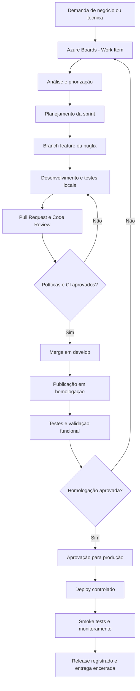

# 04 — Gestão do Desenvolvimento e Entregas

  

[[_TOC_]]

  

> **CAOA Venda Cantada Dash | Documentação técnica**

>

> **Seção:** 4 — Gestão do Desenvolvimento e Entregas

>

> **Abrangência:** Desenvolvimento, homologação e produção

>

> **Foco:** Engenharia de software, DevOps e governança de entregas

>

> **Plataforma:** Azure Boards, Azure Repos, Azure Pipelines e Azure Wiki

  

---

  

## 4.1. Apresentação

  

A gestão do desenvolvimento e das entregas do **CAOA Venda Cantada Dash** tem como finalidade organizar, controlar e acompanhar todas as atividades relacionadas à evolução da aplicação, desde a identificação de uma necessidade até sua implementação, validação, publicação e sustentação.

  

O projeto utiliza o **Microsoft Azure DevOps** como plataforma de referência para centralização das atividades de engenharia de software, oferecendo recursos para planejamento, rastreabilidade, versionamento de código, integração contínua, documentação técnica e acompanhamento das entregas.

  

A adoção de processos padronizados busca garantir que as mudanças realizadas no sistema sejam documentadas, revisadas, testadas e disponibilizadas de maneira controlada.

  

<table>

<thead>

<tr>

<th>Dimensão</th>

<th>Objetivo</th>

</tr>

</thead>

<tbody>

<tr>

<td>Planejamento</td>

<td>Organizar demandas, prioridades, responsáveis e entregas</td>

</tr>

<tr>

<td>Desenvolvimento</td>

<td>Implementar alterações seguindo padrões técnicos</td>

</tr>

<tr>

<td>Qualidade</td>

<td>Validar código, funcionalidades e integrações</td>

</tr>

<tr>

<td>Entrega</td>

<td>Controlar publicações, versões e aprovações</td>

</tr>

</tbody>

</table>

  

A integração dessas dimensões permite acompanhar o ciclo de vida completo das alterações realizadas na plataforma.

  

## 4.2. Objetivos da gestão de desenvolvimento

  

### 4.2.1. Centralização das demandas

  

Manter um repositório único para registrar funcionalidades, melhorias, correções, tarefas técnicas e demandas relacionadas à infraestrutura.

  

### 4.2.2. Rastreabilidade

  

Relacionar cada alteração implementada aos respectivos Work Items, commits, Pull Requests, builds e versões publicadas.

  

### 4.2.3. Padronização técnica

  

Estabelecer convenções de desenvolvimento, organização de branches, revisões de código e validações automatizadas.

  

### 4.2.4. Qualidade das entregas

  

Reduzir a introdução de defeitos por meio de testes, análise estática e validações funcionais.

  

### 4.2.5. Segurança das alterações

  

Controlar o acesso aos repositórios, pipelines, ambientes e recursos utilizados durante o ciclo de desenvolvimento.

  

### 4.2.6. Previsibilidade

  

Facilitar o acompanhamento de prioridades, dependências, impedimentos e evolução das entregas.

  

### 4.2.7. Continuidade operacional

  

Permitir identificar versões implantadas, recuperar artefatos e estabelecer procedimentos de rollback quando necessário.

  

### 4.2.8. Preservação do conhecimento

  

Manter documentação técnica e funcional atualizada, reduzindo a dependência de conhecimento individual.

  

---

  

## 4.3. Organização do projeto no Azure DevOps

  

<table>

<thead>

<tr>

<th>Serviço</th>

<th>Responsabilidade</th>

</tr>

</thead>

<tbody>

<tr>

<td>**Azure Boards**</td>

<td>Planejamento e acompanhamento das demandas</td>

</tr>

<tr>

<td>**Azure Repos**</td>

<td>Controle de versão e revisão de código</td>

</tr>

<tr>

<td>**Azure Pipelines**</td>

<td>Integração contínua e automação de entregas</td>

</tr>

<tr>

<td>**Azure Wiki**</td>

<td>Documentação técnica, funcional e operacional</td>

</tr>

</tbody>

</table>

  

### 4.3.1. Azure Boards

  

Responsável pelo gerenciamento do backlog do projeto. Permite registrar e acompanhar novas funcionalidades, correções de bugs, melhorias, atividades técnicas, requisitos de infraestrutura e demais necessidades identificadas.

  

### 4.3.2. Azure Repos

  

Responsável pelo armazenamento e versionamento do código-fonte, incluindo gerenciamento de branches, commits, Pull Requests e políticas de revisão.

  

### 4.3.3. Azure Pipelines

  

Responsável pela automação de processos como instalação de dependências, análise de código, verificação de tipos, compilação e, conforme a configuração adotada, testes e implantação.

  

### 4.3.4. Azure Wiki

  

Responsável pela centralização das informações necessárias à compreensão, desenvolvimento, operação e sustentação da aplicação.

  

---

  

## 4.4. Modelo de gestão de demandas

  

As demandas podem ser originadas por necessidades comerciais, solicitações de usuários, melhorias, correções, evolução técnica, infraestrutura, segurança, desempenho e sustentação. Devem ser avaliadas, classificadas e priorizadas antes da execução, salvo exceções formalmente previstas.

  

### 4.4.1. Estrutura recomendada de Work Items

  

<table>

<thead>

<tr>

<th>Tipo</th>

<th>Finalidade</th>

</tr>

</thead>

<tbody>

<tr>

<td>Epic</td>

<td>Representar iniciativa de grande abrangência</td>

</tr>

<tr>

<td>Feature</td>

<td>Agrupar funcionalidades relacionadas</td>

</tr>

<tr>

<td>User Story</td>

<td>Descrever necessidade funcional</td>

</tr>

<tr>

<td>Bug</td>

<td>Registrar comportamento incorreto</td>

</tr>

<tr>

<td>Task</td>

<td>Representar atividade técnica ou operacional</td>

</tr>

<tr>

<td>Issue</td>

<td>Registrar impedimento ou questão, quando disponível</td>

</tr>

</tbody>

</table>

  

> A disponibilidade e a nomenclatura desses tipos dependem do processo configurado no Azure Boards.

  

### 4.4.2. Hierarquia recomendada

  

```text

Epic

└── Feature

└── User Story

└── Task

  

Bug

└── Task

```

  

A posição dos Bugs na hierarquia pode variar conforme a configuração do processo.

  

### 4.4.3. Exemplo aplicado ao projeto

  

```text

Epic: Gestão de Intenções de Venda

├── Feature: Cadastro de Intenções

│ ├── User Story: Cadastrar intenção

│ │ ├── Task: Implementar interface

│ │ ├── Task: Implementar API

│ │ └── Task: Criar testes

│ └── User Story: Editar intenção

│ ├── Task: Implementar atualização

│ └── Task: Validar permissões

└── Feature: Consulta de Intenções

├── User Story: Pesquisar registros

└── User Story: Aplicar filtros

```

  

Exemplo ilustrativo, não necessariamente correspondente à hierarquia já cadastrada no Azure Boards.

  

## 4.5. Padrão de cadastro dos Work Items

  

### 4.5.1. Campos recomendados

  

<table>

<thead>

<tr>

<th>Campo</th>

<th>Descrição</th>

</tr>

</thead>

<tbody>

<tr>

<td>Title</td>

<td>Título objetivo da demanda</td>

</tr>

<tr>

<td>Description</td>

<td>Contexto e detalhamento</td>

</tr>

<tr>

<td>Work Item Type</td>

<td>Classificação</td>

</tr>

<tr>

<td>Assigned To</td>

<td>Responsável</td>

</tr>

<tr>

<td>State</td>

<td>Situação atual</td>

</tr>

<tr>

<td>Priority</td>

<td>Prioridade</td>

</tr>

<tr>

<td>Area Path</td>

<td>Área ou módulo</td>

</tr>

<tr>

<td>Iteration Path</td>

<td>Sprint ou período</td>

</tr>

<tr>

<td>Tags</td>

<td>Classificações complementares</td>

</tr>

<tr>

<td>Acceptance Criteria</td>

<td>Condições para aceite</td>

</tr>

<tr>

<td>Related Work</td>

<td>Dependências e relacionamentos</td>

</tr>

<tr>

<td>Attachments</td>

<td>Evidências e arquivos</td>

</tr>

</tbody>

</table>

  

A disponibilidade dos campos varia conforme o template e suas customizações.

  

### 4.5.2. Padrão de títulos

  

- `[BUG] Intenções de Venda — Falha ao salvar cadastro`

- `[MELHORIA] Dashboard — Otimizar carregamento de indicadores`

- `[FEATURE] Gestão de Acessos — Permitir alteração de perfis`

- `[TECH] Backend — Refatorar validação de filtros`

- `[DEVOPS] Pipeline — Implementar testes automatizados`

  

São exemplos de convenção proposta, sujeitos à aprovação da equipe.

  

### 4.5.3. Descrição de funcionalidades

  

Cada demanda funcional deve contemplar contexto, problema ou oportunidade, comportamento esperado, regras de negócio, critérios de aceite, dependências e evidências quando disponíveis.

  

**Exemplo de User Story**

  

> Como usuário autorizado, desejo consultar as intenções de venda por intervalo de datas para analisar os registros correspondentes ao período selecionado.

  

**Critérios de aceite ilustrativos:** permitir período inicial e final, validar parâmetros, retornar registros do intervalo, respeitar permissões, apresentar resultados e tratar consultas sem resultados.

  

### 4.5.4. Padrão para registro de bugs

  

<table>

<thead>

<tr>

<th>Campo</th>

<th>Conteúdo</th>

</tr>

</thead>

<tbody>

<tr>

<td>Título</td>

<td>Identificação da falha</td>

</tr>

<tr>

<td>Ambiente</td>

<td>DEV, HML ou PRD</td>

</tr>

<tr>

<td>Módulo</td>

<td>Funcionalidade afetada</td>

</tr>

<tr>

<td>Pré-condições</td>

<td>Condições necessárias</td>

</tr>

<tr>

<td>Passos para reproduzir</td>

<td>Sequência executada</td>

</tr>

<tr>

<td>Resultado atual</td>

<td>Comportamento observado</td>

</tr>

<tr>

<td>Resultado esperado</td>

<td>Comportamento correto</td>

</tr>

<tr>

<td>Impacto</td>

<td>Consequência para o usuário</td>

</tr>

<tr>

<td>Evidências</td>

<td>Prints, logs ou registros</td>

</tr>

<tr>

<td>Severidade</td>

<td>Classificação de impacto</td>

</tr>

<tr>

<td>Versão</td>

<td>Build em que ocorreu</td>

</tr>

</tbody>

</table>

  

**Exemplo:** `[BUG] Dashboard — Indicadores não atualizam após alteração de período`.

  

- **Atual:** indicadores permanecem mostrando valores anteriores.

- **Esperado:** indicadores refletem o período selecionado.

- **Impacto:** interpretação incorreta dos resultados.

- **Validação:** repetir a operação com diferentes períodos após a correção.

  

---

  

## 4.6. Fluxo de trabalho das demandas

  

<table>

<thead>

<tr>

<th>Etapa</th>

<th>Descrição</th>

</tr>

</thead>

<tbody>

<tr>

<td>Identificação</td>

<td>Registro da necessidade</td>

</tr>

<tr>

<td>Análise</td>

<td>Avaliação funcional e técnica</td>

</tr>

<tr>

<td>Priorização</td>

<td>Definição de importância e sequência</td>

</tr>

<tr>

<td>Planejamento</td>

<td>Inclusão na sprint ou fila</td>

</tr>

<tr>

<td>Desenvolvimento</td>

<td>Implementação</td>

</tr>

<tr>

<td>Code Review</td>

<td>Revisão técnica</td>

</tr>

<tr>

<td>Testes técnicos</td>

<td>Validações automatizadas e manuais</td>

</tr>

<tr>

<td>Homologação</td>

<td>Validação funcional</td>

</tr>

<tr>

<td>Aprovação</td>

<td>Aceite da entrega</td>

</tr>

<tr>

<td>Publicação</td>

<td>Disponibilização da versão</td>

</tr>

<tr>

<td>Encerramento</td>

<td>Registro de conclusão</td>

</tr>

</tbody>

</table>

  

### 4.6.1. Estados sugeridos

  

- **New:** item registrado.

- **Active:** implementação em andamento.

- **Resolved:** implementação concluída, aguardando validação.

- **Closed:** demanda validada e encerrada.

  

Estados adicionais como `Ready for QA`, `In Review`, `Blocked` e `Ready for Release` dependem da configuração e aprovação do processo.

  

### 4.6.2. Gestão de impedimentos

  

Registrar motivo, data, dependência responsável, ação necessária, impacto e situação atual do bloqueio. Manter o impedimento visível até sua resolução.

  

## 4.7. Planejamento de sprints

  

O ciclo e duração das sprints devem ser definidos pela equipe. O planejamento considera capacidade, prioridades, dependências, complexidade, riscos, homologação e critérios de conclusão.

  

<table>

<thead>

<tr>

<th>Indicador</th>

<th>Finalidade</th>

</tr>

</thead>

<tbody>

<tr>

<td>Itens planejados</td>

<td>Volume previsto</td>

</tr>

<tr>

<td>Itens concluídos</td>

<td>Entregas finalizadas</td>

</tr>

<tr>

<td>Itens em andamento</td>

<td>Execução corrente</td>

</tr>

<tr>

<td>Bugs abertos</td>

<td>Pendências</td>

</tr>

<tr>

<td>Bugs corrigidos</td>

<td>Correções implementadas</td>

</tr>

<tr>

<td>Itens bloqueados</td>

<td>Dependências impeditivas</td>

</tr>

<tr>

<td>Itens reabertos</td>

<td>Falhas de validação</td>

</tr>

<tr>

<td>Capacidade</td>

<td>Disponibilidade da equipe</td>

</tr>

</tbody>

</table>

  

No encerramento da sprint, consolidar entregas, bugs resolvidos, pendências, impedimentos, evidências e prioridades seguintes. Diferenciar implementação concluída de homologação aprovada.

  

---

  

## 4.8. Estratégia de versionamento de código

  

A estratégia de branches abaixo foi proposta na documentação e requer alinhamento formal com a equipe.

  

<table>

<thead>

<tr>

<th>Branch</th>

<th>Finalidade</th>

</tr>

</thead>

<tbody>

<tr>

<td>`main`</td>

<td>Código liberável ou referência produtiva</td>

</tr>

<tr>

<td>`develop`</td>

<td>Integração para a próxima homologação</td>

</tr>

<tr>

<td>`feature/*`</td>

<td>Novas funcionalidades</td>

</tr>

<tr>

<td>`bugfix/*`</td>

<td>Correções de defeitos</td>

</tr>

<tr>

<td>`release/*`</td>

<td>Estabilização, quando necessária</td>

</tr>

<tr>

<td>`hotfix/*`</td>

<td>Correções urgentes da versão produtiva</td>

</tr>

</tbody>

</table>

  

### 4.8.1. Exemplos de nomenclatura

  

```text

feature/1234-cadastro-intencao

feature/1235-relatorio-vendedor

bugfix/1240-correcao-filtro-periodo

bugfix/1241-ajuste-permissoes

release/1.2.0

hotfix/1250-correcao-autenticacao

```

  

O número pode corresponder ao Work Item, facilitando a rastreabilidade.

  

### 4.8.2. Fluxo recomendado

  

```text

develop

├── feature/1234-nova-funcionalidade

│ └── Desenvolvimento → Testes → PR → Merge develop

└── bugfix/1240-correcao

└── Desenvolvimento → Testes → PR → Merge develop

```

  

Após integração e homologação, a versão pode ser promovida a `main` conforme a política aprovada.

  

### 4.8.3. Correções emergenciais

  

Registrar incidente; criar `hotfix/*` a partir da referência produtiva; implementar; testar; revisar; aprovar; implantar; propagar a correção a `develop`; registrar encerramento.

  

## 4.9. Padrões de commits

  

Convenção recomendada, inspirada em Conventional Commits:

  

<table>

<thead>

<tr>

<th>Prefixo</th>

<th>Utilização</th>

</tr>

</thead>

<tbody>

<tr>

<td>`feat`</td>

<td>Nova funcionalidade</td>

</tr>

<tr>

<td>`fix`</td>

<td>Correção</td>

</tr>

<tr>

<td>`refactor`</td>

<td>Refatoração</td>

</tr>

<tr>

<td>`test`</td>

<td>Testes</td>

</tr>

<tr>

<td>`docs`</td>

<td>Documentação</td>

</tr>

<tr>

<td>`chore`</td>

<td>Manutenção técnica</td>

</tr>

<tr>

<td>`perf`</td>

<td>Performance</td>

</tr>

<tr>

<td>`build`</td>

<td>Build</td>

</tr>

<tr>

<td>`ci`</td>

<td>CI/CD</td>

</tr>

</tbody>

</table>

  

```text

feat: adiciona filtro por vendedor

fix: corrige validação de período

refactor: reorganiza serviço de intenções

test: adiciona testes do controller

docs: atualiza documentação da API

ci: ajusta pipeline de build

```

  

Associar commits e PRs aos Work Items conforme a convenção adotada.

  

---

  

## 4.10. Pull Requests e revisão de código

  

O PR é o mecanismo recomendado para integração de alterações em branches protegidas.

  

### 4.10.1. Objetivos

  

Revisar aderência à arquitetura, identificar defeitos, avaliar segurança e impacto, verificar testes e registrar observações e aprovações.

  

### 4.10.2. Conteúdo esperado

  

<table>

<thead>

<tr>

<th>Campo</th>

<th>Descrição</th>

</tr>

</thead>

<tbody>

<tr>

<td>Título</td>

<td>Resumo da alteração</td>

</tr>

<tr>

<td>Descrição</td>

<td>Contexto e solução</td>

</tr>

<tr>

<td>Work Items</td>

<td>Demandas vinculadas</td>

</tr>

<tr>

<td>Branch origem e destino</td>

<td>Caminho de integração</td>

</tr>

<tr>

<td>Testes</td>

<td>Validações realizadas</td>

</tr>

<tr>

<td>Evidências</td>

<td>Logs, prints e relatórios</td>

</tr>

<tr>

<td>Impactos</td>

<td>API, banco ou configuração</td>

</tr>

<tr>

<td>Riscos</td>

<td>Possíveis efeitos colaterais</td>

</tr>

</tbody>

</table>

  

### 4.10.3. Políticas recomendadas

  

PR obrigatório em `main` e `develop`, revisores mínimos, builds obrigatórios, comentários resolvidos, bloqueio de push direto e vínculo com Work Items. Definir quantidades de revisores e critérios com a equipe.

  

### 4.10.4. Checklist de revisão

  

- [ ] Alteração vinculada à demanda.

- [ ] Código segue os padrões existentes.

- [ ] Regras de negócio preservadas.

- [ ] Entradas validadas adequadamente.

- [ ] Permissões verificadas.

- [ ] Segredos ausentes do código.

- [ ] Testes realizados.

- [ ] Ausência de falhas bloqueantes conhecidas.

- [ ] Alterações de banco avaliadas.

- [ ] Documentação atualizada, quando necessário.

  

---

  

## 4.11. Integração contínua — CI

  

O projeto possui configuração geral no arquivo `azure-pipelines.yml`, com execução documentada em pushes para `main` e `develop`.

  

<table>

<thead>

<tr>

<th>Item</th>

<th>Configuração documentada</th>

</tr>

</thead>

<tbody>

<tr>

<td>Serviço</td>

<td>Azure Pipelines</td>

</tr>

<tr>

<td>Agente</td>

<td>`ubuntu-24.04`</td>

</tr>

<tr>

<td>Node.js</td>

<td>24</td>

</tr>

<tr>

<td>pnpm</td>

<td>11.1.3</td>

</tr>

<tr>

<td>Instalação</td>

<td>`pnpm install --frozen-lockfile`</td>

</tr>

<tr>

<td>ORM</td>

<td>Geração do Prisma Client</td>

</tr>

<tr>

<td>Qualidade</td>

<td>Lint e verificação TypeScript</td>

</tr>

<tr>

<td>Compilação</td>

<td>Backend e frontend</td>

</tr>

</tbody>

</table>

  

### 4.11.1. Etapas documentadas

  

1. Obtenção do código e preparação do agente.

2. Instalação das dependências.

3. Geração do Prisma Client.

4. Execução do lint.

5. Verificação de tipos no frontend e backend.

6. Build dos dois componentes.

7. Registro do resultado.

  

### 4.11.2. Limitações registradas

  

A descrição do pipeline geral de CI indica que ele ainda não executa testes unitários/E2E, não publica artefatos e não faz deploy. **Existe também documentação de um processo específico de deploy nativo em homologação**; a situação dos dois fluxos deve ser verificada separadamente no Azure DevOps.

  

## 4.12. Testes e garantia de qualidade

  

<table>

<thead>

<tr>

<th>Categoria</th>

<th>Ferramenta</th>

</tr>

</thead>

<tbody>

<tr>

<td>Unitários</td>

<td>Vitest</td>

</tr>

<tr>

<td>Componentes</td>

<td>Testing Library</td>

</tr>

<tr>

<td>Eventos de interface</td>

<td>user-event</td>

</tr>

<tr>

<td>Integração HTTP</td>

<td>Supertest</td>

</tr>

<tr>

<td>E2E</td>

<td>Playwright</td>

</tr>

<tr>

<td>Análise estática</td>

<td>ESLint</td>

</tr>

<tr>

<td>Tipagem</td>

<td>TypeScript</td>

</tr>

</tbody>

</table>

  

```bash

pnpm test:unit

pnpm test:coverage

pnpm test:e2e

pnpm test:all

```

  

Os testes E2E documentados cobrem fluxos como navegação, rota protegida e login, sem automatizar o login Microsoft real. Metas de cobertura devem ser formalizadas. O histórico menciona k6, mas os arquivos/scripts de carga não estavam presentes no repositório revisado.

  

---

  

## 4.13. Gestão de homologação

  

A homologação confirma que as entregas atendem aos critérios de aceite e apresentam comportamento adequado no ambiente de validação.

  

### 4.13.1. Fluxo recomendado

  

1. Publicar versão em HML.

2. Identificar funcionalidades incluídas.

3. Preparar cenários de teste.

4. Executar testes técnicos e funcionais.

5. Registrar evidências.

6. Abrir Bugs para problemas identificados.

7. Revalidar correções.

8. Consolidar resultados.

9. Aprovar, reprovar ou bloquear a entrega.

  

### 4.13.2. Evidências

  

Prints, registros de erro, resultados de testes, versão, ambiente, responsável, data e comportamento esperado/observado, sem expor credenciais, tokens ou dados pessoais desnecessários.

  

<table>

<thead>

<tr>

<th>Situação</th>

<th>Significado</th>

</tr>

</thead>

<tbody>

<tr>

<td>Aprovado</td>

<td>Critérios atendidos</td>

</tr>

<tr>

<td>Aprovado com ressalvas</td>

<td>Pendências aceitas formalmente</td>

</tr>

<tr>

<td>Reprovado</td>

<td>Problemas impedem aceite</td>

</tr>

<tr>

<td>Bloqueado</td>

<td>Validação depende de outra atividade</td>

</tr>

<tr>

<td>Não executado</td>

<td>Cenário ainda não validado</td>

</tr>

</tbody>

</table>

  

A aprovação com ressalvas depende de critérios formais de severidade e risco.

  

## 4.14. Entrega contínua e publicação — CD

  

A evolução **proposta** contempla instalação e testes em CI; publicação de artefatos; deploy de homologação; smoke tests; aprovação de produção; promoção dos mesmos artefatos; e validação pós-deploy.

  

### 4.14.1. Referência de homologação documentada

  

<table>

<thead>

<tr>

<th>Configuração</th>

<th>Valor</th>

</tr>

</thead>

<tbody>

<tr>

<td>Branch</td>

<td>`develop`</td>

</tr>

<tr>

<td>Environment</td>

<td>`homolog`</td>

</tr>

<tr>

<td>Pool</td>

<td>`VendaCantada-Homolog`</td>

</tr>

<tr>

<td>Variable Group</td>

<td>`vg-venda-cantada-homolog`</td>

</tr>

<tr>

<td>Arquivo de ambiente</td>

<td>`D:\Apps\VendaCantadaHml\config\.env.homolog`</td>

</tr>

</tbody>

</table>

  

### 4.14.2. Produção proposta

  

Publicação de imagens no Azure Container Registry; tags imutáveis por build/commit; promoção dos mesmos artefatos homologados; aprovação manual e checks no Environment; health checks; e rollback previamente definido. Essas etapas dependem de aprovação arquitetural e implementação.

  

---

  

## 4.15. Versionamento das entregas

  

Recomenda-se avaliar o versionamento semântico `MAJOR.MINOR.PATCH`, por exemplo `1.2.3`.

  

<table>

<thead>

<tr>

<th>Elemento</th>

<th>Significado</th>

</tr>

</thead>

<tbody>

<tr>

<td>MAJOR</td>

<td>Alterações incompatíveis</td>

</tr>

<tr>

<td>MINOR</td>

<td>Novas funcionalidades compatíveis</td>

</tr>

<tr>

<td>PATCH</td>

<td>Correções compatíveis</td>

</tr>

</tbody>

</table>

  

Cada release deve permitir identificar versão, commit, build, data, ambiente, Work Items, aprovador e resultado.

  

### 4.15.1. Modelo de Release Notes

  

```markdown

# Release 1.2.0

  

**Ambiente:** Homologação

**Data:** A definir

  

## Novas funcionalidades

- [Descrever]

  

## Melhorias

- [Descrever]

  

## Correções

- [Descrever]

  

## Alterações técnicas

- [Descrever]

  

## Pendências conhecidas

- [Descrever]

  

## Validação

- [Resultado e responsável]

```

  

## 4.16. Gestão de mudanças em banco de dados

  

O projeto utiliza Prisma com migrations em `backend/prisma/migrations/`.

  

### 4.16.1. Processo recomendado

  

1. Identificar e analisar a alteração.

2. Atualizar `backend/prisma/schema.prisma`.

3. Preparar a migration.

4. Validar em DEV.

5. Revisar o código e a compatibilidade.

6. Testar em HML.

7. Planejar recuperação e execução.

8. Aplicar em produção com controle.

  

**Cuidados:** confirmar banco de destino; avaliar views, índices e integrações; não executar seeds destrutivos em produção; registrar evidências; não presumir que migrations são reversíveis automaticamente.

  

## 4.17. Gestão de releases e rollback

  

Rollback pode ser necessário diante de falha crítica na inicialização, indisponibilidade, erro generalizado de autenticação, falhas essenciais, problemas graves de integração ou incidentes causados pela publicação.

  

### 4.17.1. Procedimento recomendado

  

1. Identificar o incidente e sua abrangência.

2. Suspender novas promoções.

3. Acionar responsáveis.

4. Identificar versão estável anterior.

5. Avaliar compatibilidade do banco.

6. Executar recuperação aprovada.

7. Verificar serviços e fluxos essenciais.

8. Registrar evidências e causa-raiz.

  

Reverter a aplicação **não** implica automaticamente reverter alterações de dados ou schema.

  

---

  

## 4.18. Segurança e governança do Azure DevOps

  

<table>

<thead>

<tr>

<th>Recurso</th>

<th>Controle recomendado</th>

</tr>

</thead>

<tbody>

<tr>

<td>Boards</td>

<td>Permissões por participação</td>

</tr>

<tr>

<td>Repos</td>

<td>Acesso de leitura, contribuição e administração</td>

</tr>

<tr>

<td>Pull Requests</td>

<td>Revisores e políticas</td>

</tr>

<tr>

<td>Pipelines</td>

<td>Permissões de edição e execução</td>

</tr>

<tr>

<td>Service Connections</td>

<td>Escopo mínimo</td>

</tr>

<tr>

<td>Variable Groups</td>

<td>Proteção de variáveis sensíveis</td>

</tr>

<tr>

<td>Environments</td>

<td>Aprovações e checks</td>

</tr>

<tr>

<td>Wiki</td>

<td>Edição conforme responsabilidade</td>

</tr>

</tbody>

</table>

  

Credenciais não devem aparecer em código, commits, Work Items, logs ou páginas da Wiki. Aprovações de produção devem ser configuradas em checks do Environment, fora do YAML, conforme proposta de governança.

  

## 4.19. Indicadores de acompanhamento

  

<table>

<thead>

<tr>

<th>Indicador</th>

<th>Objetivo</th>

</tr>

</thead>

<tbody>

<tr>

<td>Demandas criadas</td>

<td>Entrada de trabalho</td>

</tr>

<tr>

<td>Demandas concluídas</td>

<td>Saída do fluxo</td>

</tr>

<tr>

<td>Lead Time</td>

<td>Tempo entre criação e conclusão</td>

</tr>

<tr>

<td>Cycle Time</td>

<td>Tempo de execução</td>

</tr>

<tr>

<td>Bugs abertos</td>

<td>Pendências</td>

</tr>

<tr>

<td>Bugs reabertos</td>

<td>Problemas de validação</td>

</tr>

<tr>

<td>Conclusão da sprint</td>

<td>Planejado versus concluído</td>

</tr>

<tr>

<td>Builds com falha</td>

<td>Estabilidade de integração</td>

</tr>

<tr>

<td>Cobertura de testes</td>

<td>Alcance das validações</td>

</tr>

<tr>

<td>Frequência de deploy</td>

<td>Ritmo de publicações</td>

</tr>

<tr>

<td>Falhas pós-deploy</td>

<td>Qualidade das entregas</td>

</tr>

<tr>

<td>Tempo de recuperação</td>

<td>Resposta a incidentes</td>

</tr>

</tbody>

</table>

  

As fórmulas, metas, fontes de dados e periodicidade ainda devem ser definidas formalmente.

  

## 4.20. Papéis e responsabilidades

  

<table>

<thead>

<tr>

<th>Papel</th>

<th>Responsabilidades propostas</th>

</tr>

</thead>

<tbody>

<tr>

<td>Product Owner / Negócio</td>

<td>Priorizar e validar requisitos</td>

</tr>

<tr>

<td>Analista de Sistemas</td>

<td>Análise funcional e técnica</td>

</tr>

<tr>

<td>Desenvolvedor</td>

<td>Implementação e testes</td>

</tr>

<tr>

<td>Tech Lead</td>

<td>Orientação e revisão</td>

</tr>

<tr>

<td>QA</td>

<td>Planejar e executar validações</td>

</tr>

<tr>

<td>Key User</td>

<td>Homologação de regras de negócio</td>

</tr>

<tr>

<td>DevOps</td>

<td>CI/CD e implantação</td>

</tr>

<tr>

<td>DBA</td>

<td>Administração do banco</td>

</tr>

<tr>

<td>Segurança</td>

<td>Avaliar acessos e riscos</td>

</tr>

<tr>

<td>Gestor responsável</td>

<td>Aprovações previstas na governança</td>

</tr>

</tbody>

</table>

  

Matriz proposta: responsáveis nominais devem ser definidos pela organização.

  

---

  

## 4.21. Backlog de evolução do Azure DevOps

  

A documentação registra um backlog de planejamento identificado de `PB-104` a `PB-131`, organizado em planejamento, Azure DevOps, Repos, Boards, governança, segurança, infraestrutura, CI, CD, qualidade, banco, monitoramento, continuidade e documentação.

  

<table>

<thead>

<tr>

<th>Grupo</th>

<th>Escopo</th>

</tr>

</thead>

<tbody>

<tr>

<td>Planejamento</td>

<td>Arquitetura e requisitos</td>

</tr>

<tr>

<td>Azure DevOps</td>

<td>Configuração do projeto</td>

</tr>

<tr>

<td>Azure Repos</td>

<td>Migração e versionamento</td>

</tr>

<tr>

<td>Azure Boards</td>

<td>Backlog, sprints e tarefas</td>

</tr>

<tr>

<td>Governança</td>

<td>Nomenclatura e ownership</td>

</tr>

<tr>

<td>Segurança</td>

<td>RBAC, certificados e segredos</td>

</tr>

<tr>

<td>Infraestrutura</td>

<td>IaC e ambientes</td>

</tr>

<tr>

<td>CI</td>

<td>Builds e testes</td>

</tr>

<tr>

<td>CD</td>

<td>Publicação automatizada</td>

</tr>

<tr>

<td>Qualidade</td>

<td>Gates e cobertura</td>

</tr>

<tr>

<td>Banco</td>

<td>Migrations controladas</td>

</tr>

<tr>

<td>Monitoramento</td>

<td>Logs, alertas e indicadores</td>

</tr>

<tr>

<td>Continuidade</td>

<td>Backup e recuperação</td>

</tr>

<tr>

<td>Documentação</td>

<td>Wiki e handover</td>

</tr>

</tbody>

</table>

  

> Os códigos `PB-104` a `PB-131` são identificadores do planejamento de referência, não necessariamente IDs reais do Azure Boards. Verificar e vincular aos Work Items efetivamente criados.

  

## 4.22. Definition of Ready — DoR

  

Checklist **proposto** para entrada em desenvolvimento:

  

- [ ] Objetivo compreendido.

- [ ] Descrição detalhada.

- [ ] Critérios de aceite definidos.

- [ ] Dependências identificadas.

- [ ] Regras de negócio esclarecidas.

- [ ] Impactos técnicos avaliados.

- [ ] Prioridade definida.

- [ ] Responsável ou equipe identificada.

- [ ] Informações necessárias disponíveis.

  

## 4.23. Definition of Done — DoD

  

Checklist **proposto** de conclusão:

  

- [ ] Implementação concluída.

- [ ] Código versionado.

- [ ] Work Item vinculado.

- [ ] Pull Request revisado.

- [ ] Pipeline obrigatório aprovado.

- [ ] Testes técnicos executados.

- [ ] Critérios de aceite atendidos.

- [ ] Testes funcionais aplicáveis realizados.

- [ ] Bugs bloqueantes resolvidos.

- [ ] Documentação atualizada.

- [ ] Mudanças de banco avaliadas.

- [ ] Homologação aprovada, quando exigida.

- [ ] Release registrado.

- [ ] Publicação validada, quando parte do escopo.

  

Diferenciar **Desenvolvimento Concluído**, **Homologado** e **Publicado**.

  

---

  

## 4.24. Checklist de entrega

  

### Antes do desenvolvimento

  

- [ ] Demanda registrada.

- [ ] Escopo definido.

- [ ] Critérios de aceite disponíveis.

- [ ] Dependências identificadas.

- [ ] Branch criada.

  

### Durante o desenvolvimento

  

- [ ] Código implementado.

- [ ] Validações aplicadas.

- [ ] Testes criados ou atualizados.

- [ ] Commits realizados.

- [ ] Documentação revisada.

  

### Antes do merge

  

- [ ] Pull Request criado.

- [ ] Work Item vinculado.

- [ ] Build executado.

- [ ] Revisão concluída.

- [ ] Comentários resolvidos.

- [ ] Políticas satisfeitas.

  

### Homologação

  

- [ ] Versão publicada.

- [ ] Cenários executados.

- [ ] Evidências registradas.

- [ ] Problemas documentados.

- [ ] Critérios de aceite conferidos.

- [ ] Aprovação registrada.

  

### Produção

  

- [ ] Versão homologada.

- [ ] Aprovação obtida.

- [ ] Plano de publicação definido.

- [ ] Plano de recuperação disponível.

- [ ] Implantação realizada.

- [ ] Health check validado.

- [ ] Operações verificadas.

- [ ] Release documentado.

  

## 4.25. Evolução e melhoria contínua

  

Revisar eficiência do fluxo, qualidade das especificações, retrabalho, bugs, revisões, cobertura de testes, confiabilidade das pipelines, homologações, publicações e documentação.

  

### 4.25.1. Evoluções previstas na documentação

  

1. Consolidar desenvolvimento no Azure DevOps.

2. Ampliar verificações automatizadas do CI.

3. Incorporar testes unitários/E2E ao pipeline Azure.

4. Publicar artefatos versionados.

5. Evoluir deploy de homologação.

6. Formalizar aprovações produtivas.

7. Implantar validações pós-deploy.

8. Desenvolver rollback.

9. Ampliar monitoramento e rastreabilidade.

10. Evoluir infraestrutura segundo a arquitetura Azure aprovada.

  

## 4.26. Referências técnicas

  

<table>

<thead>

<tr>

<th>Recurso</th>

<th>Localização</th>

</tr>

</thead>

<tbody>

<tr>

<td>Pipeline Azure</td>

<td>`azure-pipelines.yml`</td>

</tr>

<tr>

<td>Workflow GitHub</td>

<td>`.github/workflows/docker-image.yml`</td>

</tr>

<tr>

<td>Dependências</td>

<td>`package.json`</td>

</tr>

<tr>

<td>Backend</td>

<td>`backend/`</td>

</tr>

<tr>

<td>Frontend</td>

<td>`frontend/`</td>

</tr>

<tr>

<td>Testes E2E</td>

<td>`e2e/`</td>

</tr>

<tr>

<td>Schema Prisma</td>

<td>`backend/prisma/schema.prisma`</td>

</tr>

<tr>

<td>Migrations</td>

<td>`backend/prisma/migrations/`</td>

</tr>

<tr>

<td>Docker local</td>

<td>`docker-compose.yml`</td>

</tr>

<tr>

<td>Docker produção</td>

<td>`docker-compose.prod.yml`</td>

</tr>

<tr>

<td>IIS</td>

<td>`deploy/iis/web.config`</td>

</tr>

<tr>

<td>Documentação API</td>

<td>`/docs`</td>

</tr>

<tr>

<td>Contrato OpenAPI</td>

<td>`/openapi.json`</td>

</tr>

<tr>

<td>Backlog de implantação</td>

<td>`PB-104` a `PB-131` (planejamento)</td>

</tr>

</tbody>

</table>

  

## 4.27. Considerações finais

  

A gestão do desenvolvimento e das entregas do **CAOA Venda Cantada Dash** busca estabelecer um processo estruturado para planejamento, implementação, validação e disponibilização das evoluções da plataforma.

  

A integração entre Azure Boards, Azure Repos, Azure Pipelines e Azure Wiki permite organizar as informações e construir uma cadeia de rastreabilidade entre necessidades de negócio, atividades técnicas, alterações de código e versões da aplicação.

  

A padronização dos Work Items, revisões, testes, homologação e publicação contribui para reduzir riscos e melhorar a previsibilidade das entregas. O processo deve evoluir conforme as necessidades da operação e a maturidade da equipe.

  

---

  

## 4.28. Fluxo visual de desenvolvimento e entregas

  



  

*Fluxo de referência proposto. Etapas, aprovações e automações dependem das políticas efetivamente configuradas.*

  

---

  

**CAOA — Sistemas e Inovação Tecnológica**

*CAOA Venda Cantada Dash — Gestão do Desenvolvimento e Entregas*